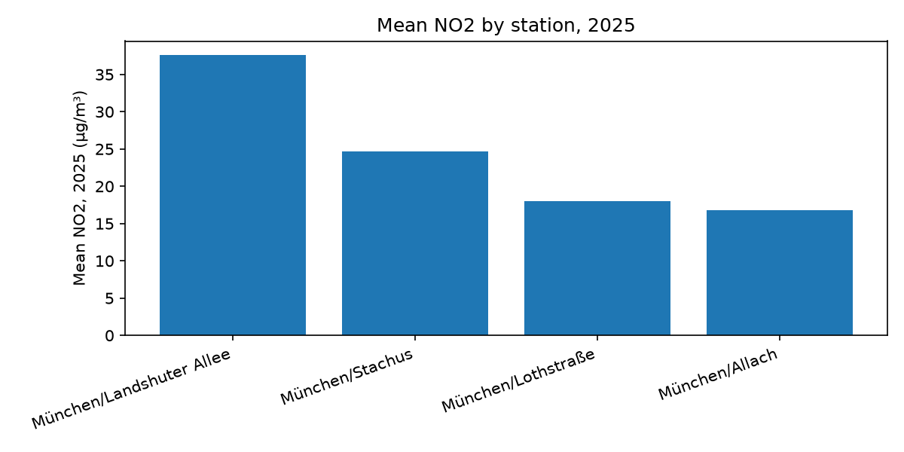
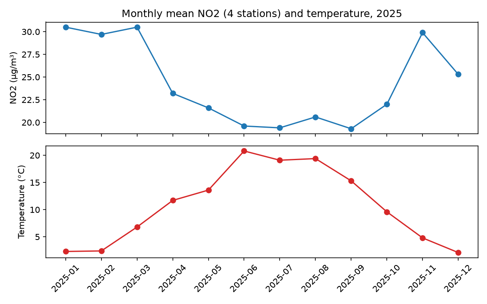
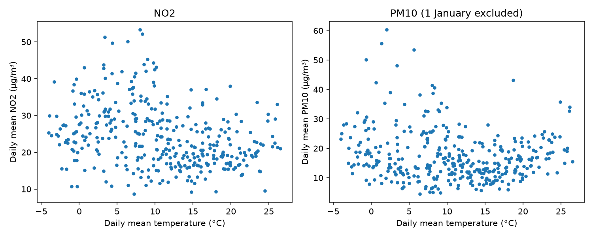

# Munich air quality and temperature

Status: first version completed.

## Question
How are NO2 and PM10 concentrations at Munich monitoring stations related to air temperature in 2025?

## Data
- Air quality: Umweltbundesamt (UBA) Luftdaten API, hourly values, 2025.
  Source: "Umweltbundesamt mit Daten der Messnetze der Länder und des Bundes".
  Licence: Datenlizenz Deutschland – Namensnennung – Version 2.0 (as listed in the catalogue record for the API).
- Temperature: Deutscher Wetterdienst (DWD) Climate Data Center, station München-Stadt (03379), hourly air temperature in °C.
  Licence: CC BY 4.0 (DWD terms for the CDC OpenData area: https://opendata.dwd.de/climate_environment/CDC/Nutzungsbedingungen_German.pdf).
  Datenbasis: Deutscher Wetterdienst, eigene Bearbeitung (values converted, joined and averaged).

  ## How to reproduce

1. Clone the repository and open it in VS Code (or GitHub Codespaces).
2. Create and activate a virtual environment:
   ```
   python -m venv .venv
   source .venv/bin/activate
   ```
   On Windows PowerShell, activate with `.\.venv\Scripts\Activate.ps1` instead.
3. Install the libraries:
   ```
   python -m pip install -r requirements.txt
   ```
4. Open `01_station_metadata.ipynb` and run all cells (internet connection needed). The notebook downloads the data, cleans it and creates the SQLite database `munich_air_temp.db`.

## Data quality notes munich_air_temp.db
- DWD marks missing values with -999. These were converted to empty values: 99 hours of temperature over 1997 to 2025, 72 of them in 2025.
- Temperature gaps in 2025: one continuous gap of 69 hours (22 April 2025 13:00 UTC to 25 April 2025 09:00 UTC) and 3 single missing hours in November. The gaps were left empty and not filled.
- Time zones: DWD times are in UTC. The UBA documentation says CET/CEST, but both clock-change days in 2025 (30 March and 26 October) have 24 hourly values, which suggests the UBA uses a fixed CET (UTC+1) all year, without summer time. This is an assumption. Before joining, we converted the UBA times to UTC, so that both tables use the same clock.
- Air quality gaps: not all hours are present. For example, Lothstraße NO2 has 8591 of 8760 values.
- Allach (DEBY189): no PM10 data found in 2025.
- PM10 above 100 µg/m³ occurred in 28 hours: 21 on 1 January (most likely New Year's fireworks), 5 on 9 December at three stations (cause unknown), 1 on 24 January, 1 on 7 August. These values were kept.
- Join: NO2 and temperature were joined on the hour (UTC). 288 NO2 rows have no temperature (72 hours × 4 stations).

## Results
All values are for 2025: four Munich stations (UBA) and München-Stadt (DWD).

**NO2 is higher at traffic stations than at background stations.** Mean NO2: Landshuter Allee 37.6 µg/m³ and Stachus 24.7 (traffic); Lothstraße 18.0 and Allach 16.8 (background).



**PM10 differs less between stations.** Mean PM10: Landshuter Allee 19.2, Stachus 18.8, Lothstraße 15.3 µg/m³ (no PM10 data for Allach).

**NO2 is higher in colder months.** The monthly mean NO2 (4 stations) was 30.5 µg/m³ in January and March and 19.3 in September, while the monthly mean temperature ranged from 2.1 °C (December) to 20.8 °C (June).



**The day-to-day association is weak.** Correlation of daily mean NO2 with daily mean temperature: -0.3. For PM10: -0.15 (1 January excluded, see data quality notes). The points scatter widely.



These are associations, not causes.

## Limitations
- One year (2025) and one temperature station (München-Stadt) for all four air quality stations.
- The time alignment of the two sources rests on an assumption (see data quality notes).
- Gaps were left empty and not filled.
- Daily means are averaged over all stations, so traffic and background stations are mixed. PM10 has only three stations.
- Only a simple linear correlation was calculated. Other factors (wind, traffic volume, heating) were not examined, so the reasons for the seasonal pattern are not known.
- Associations, not causes.

## AI assistance
AI assistance (Claude) was used for learning and debugging. I ran the code myself, checked the outputs and documented the data quality problems.